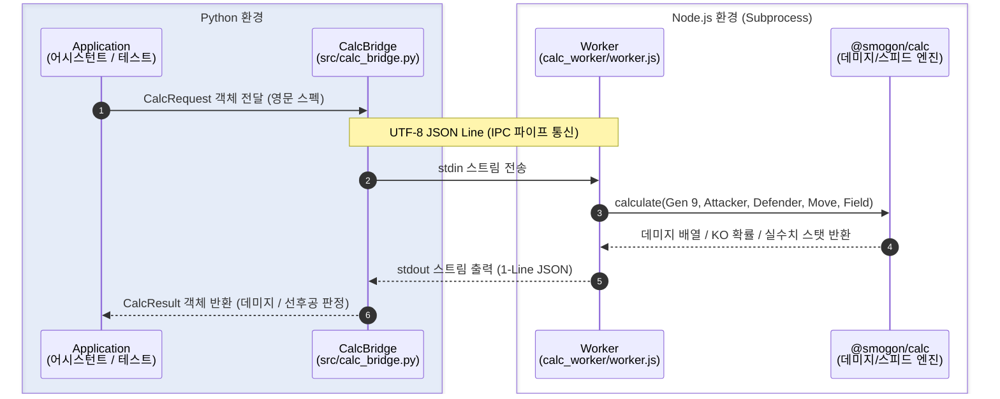

# 포챔스 배틀 어시스턴트 — Step 1: 계산 엔진 통합 가이드

포켓몬 챔피언스(포챔스) 배틀 어시스턴트의 **Step 1: 데미지 및 스탯 계산 엔진 통합**에 관한 전체 구현 과정, 세팅 방법, 아키텍처 및 트러블슈팅 정리 문서입니다.

---

## 1. 개요 (Overview)

포켓몬 배틀 분석 및 시뮬레이션을 위해 데미지 계산 라이브러리인 `@smogon/calc`(Node.js)를 Python 백엔드 환경과 연동하는 고속 IPC(표준 입출력 파이프) 브릿지를 구축했습니다.

* **계산 엔진**: `@smogon/calc` (Node.js)
* **어시스턴트 코어**: Python 3 (3.10 이상 권장, 3.13 호환)
* **프로토콜**: stdin / stdout 기반의 라인 단위 JSON-RPC 통신

---

## 2. 사전 준비 및 환경 세팅 (Setup Guide)

### 2.1 필수 요구 사양
* **Node.js**: v18.0.0 이상
* **Python**: v3.10 이상
* **OS**: Windows <!-- / macOS / Linux (Windows 외 환경에서 테스트 안 해봄) -->

---

### 2.2 의존성 설치

#### 1) Node.js 패키지 설치
프로젝트 루트 디렉토리(`pochamps-assistant`)에서 아래 명령어를 실행하여 데미지 계산 라이브러리를 설치합니다:
```bash
npm install
```
설치되는 주요 의존성:
* `@smogon/calc`: 포켓몬 쇼다운 공식 데미지 계산 라이브러리

#### 2) Python 환경 구성
가상환경을 생성 및 활성화한 뒤, `requirements.txt`를 통해 테스트 및 개발 의존성을 설치합니다:
```bash
python -m venv .venv
.\.venv\Scripts\activate
pip install -r requirements.txt
```

---

### 2.3 Windows 환경 인코딩 설정 (중요)
Windows 환경의 기본 터미널(PowerShell/CMD)은 `CP949`를 기본 인코딩으로 사용하므로, 이모지(`✅`) 및 한글 텍스트 출력 시 인코딩 오류가 발생할 수 있습니다. 터미널 세션에서 아래 환경 변수를 설정합니다:

**PowerShell:**
```powershell
$env:PYTHONIOENCODING = "utf-8"
```

**CMD:**
```cmd
set PYTHONIOENCODING=utf-8
```

---

## 3. 시스템 아키텍처 (Architecture)



### 3.1 프로젝트 파일 구조
```text
pochamps-assistant/
├── .venv/                  # Python 가상환경
├── node_modules/           # Node.js 의존성 패키지
├── calc_worker/
│   └── worker.js           # Node.js @smogon/calc 래퍼 워커
├── data/
│   ├── ko_to_en.json       # 한국어→영어 매핑 사전
│   ├── my_team.json        # 내 팀 포켓몬 정보
│   └── meta_samples.json   # 상대 메타 포켓몬 샘플 세트
├── docs/
│   └── STEP1_GUIDE.md      # 본 문서 (Step 1 가이드)
├── src/
│   ├── __init__.py         # 코어 패키지 선언
│   ├── schemas.py          # 요청/응답 데이터 모델 (Dataclass)
│   └── calc_bridge.py      # Python ↔ Node.js IPC 서브프로세스 브릿지
├── package.json            # Node.js 패키지 정의
├── requirements.txt        # Python 의존성 목록
└── test_step1_calc.py      # Step 1 검증 통합 테스트 스위트
```

---

## 4. Step 1 상세 구현 과정

### 4.1 Node.js 계산 워커 (`calc_worker/worker.js`)
* Python 프로세스로부터 `stdin`을 통해 JSON 라인을 한 줄씩 입력받아 파싱합니다.
* 9세대(SV)를 기본으로 하며, 요청 시 임의 세대(`gen`) 설정이 가능합니다.
* **메가진화 및 리전폼 기본 지원**:
  * 별도의 매핑 파일 없이 `@smogon/calc`가 자체 지원하는 종족명(`species`) 규격(예: `Garchomp-Mega`, `Charizard-Mega-X`, `Ninetales-Alola`)을 그대로 전달받아 처리합니다.
* **0배 무효 상성 특수 처리**:
  * 공격 상성이 0배(무효)여서 데미지가 `0`인 경우 `@smogon/calc`의 `result.fullDesc("%", false)` 옵션을 활용해 내부 예외 발생을 방지합니다.
  * 설명 문구 뒤에 `-- 효과 없음`을 추가하여 배틀 UI에 직관적인 결과를 전달합니다.
* 계산된 수치(최소/최대 데미지 난수 배열, 퍼센트, KO 확률 문구, 스탯)를 `stdout`으로 한 줄 JSON 형태로 출력합니다.

### 4.2 Python 데이터 스키마 (`src/schemas.py`)
* `StatSpread`: HP, 공격, 방어, 특수공격, 특수방어, 스피드 분배 (EVs / IVs).
* `Boosts`: 랭크 변화 (-6 ~ +6).
* `PokemonInput`: 종족명(일반/메가진화/리전폼 포함), 레벨, 지닌물건, 특성, 성격, 노력치/개체값, 상태이상.
* `FieldInput`: 날씨(Sun, Rain 등), 필드(Electric, Grassy 등), 벽(리플렉터, 빛의장막 등), 장판(스텔스록, 압정).
* `CalcRequest`: 계산 요청 컨테이너.
* `CalcResult`: 데미지 배열, 기술 설명 문구, 스피드 및 실수치 반환 컨테이너.

### 4.3 Python ↔ Node.js 브릿지 (`src/calc_bridge.py`)
* `subprocess.Popen`을 사용해 Node.js 프로세스를 백그라운드로 띄워 유지(Keep-Alive)함으로써 매 계산마다 프로세스를 새로 띄우는 오버헤드를 제거했습니다.
* **컨텍스트 매니저 지원**: `with CalcBridge() as bridge:` 구문으로 안전한 시작 및 프로세스 종료 보장.
* **Windows 파이프 안정성 확보**:
  * 프로세스 입출력 스트림을 `utf-8-sig`로 열어 BOM 및 한글 인코딩 깨짐을 완벽 방지.
  * `_read_response()` 메서드를 통해 JSON 시작 문자(`{` 또는 `[`)를 안전하게 필터링하여 빈 개행이나 선행 환경 텍스트로 인한 파싱 에러 방지.

---

## 5. 트러블슈팅 이력 (Troubleshooting History)

| 번호 | 증상 | 원인 | 해결 방법 |
| :--- | :--- | :--- | :--- |
| **1** | 한카리아스 방어 시 계산 실패 (`damage[damage.length - 1] === 0.`) | 피카츄 10만볼트 등 땅 타입 0배(무효) 공격 시 `@smogon/calc`의 `desc()` 내부에서 예외 throw | `worker.js`에서 데미지 0 감지 시 `err=false` 옵션을 넘기고 문구 뒤에 `-- 효과 없음` 추가 |
| **2** | Windows 콘솔 실행 시 `UnicodeEncodeError` | 콘솔 기본 인코딩(CP949)이 출력문 내 이모지(`✅`, `🎉`)를 인코딩하지 못함 | `$env:PYTHONIOENCODING="utf-8"` 설정 안내 및 스크립트 인코딩 보장 |
| **3** | `JSONDecodeError: Expecting value: line 1 column 1 (char 0)` | Windows 파이프 통신 중 `utf-8` 기본 디코딩 시 UTF-8 BOM(`\ufeff`) 또는 빈 개행이 먼저 읽힘 | `calc_bridge.py`에 `utf-8-sig` 인코딩 적용 및 `_read_response()` 라인 필터링 로직 구현 |

---

## 6. 테스트 및 검증 방법 (Testing)

### 6.1 테스트 스크립트 실행
프로젝트 루트에서 다음 명령어를 실행합니다:

```powershell
# Windows PowerShell
$env:PYTHONIOENCODING = "utf-8"
python test_step1_calc.py
```

또는 `pytest` 사용 시:
```bash
python -m pytest test_step1_calc.py -v -s
```

### 6.2 포함된 테스트 케이스 ([`test_step1_calc.py`](../test_step1_calc.py))
1. **`test_basic_damage_calc`**:
   * 공격: 한카리아스 (생명의구슬, 지진)
   * 방어: 메타그로스 (클리어바디, HP 252)
   * 검증: 물리 땅 기술에 대한 기본 데미지 및 설명 생성 확인.
2. **`test_field_weather_calc`**:
   * 공격: 리자몽 (맹화, 불대문자)
   * 방어: 메타그로스
   * 필드: 쾌청 (Sun)
   * 검증: 날씨 배율(1.5배) 적용 데미지 정상 계산 확인.
3. **`test_dict_based_calc`**:
   * 공격: 피카츄 (전기구슬, 10만볼트)
   * 방어: 한카리아스 (Garchomp)
   * 검증: 무효 상성(전기 ➔ 땅) 시 에러 없이 `0-0 (0 - 0%) -- 효과 없음` 출력 확인.
4. **`test_speed_comparison`**:
   * 비교: 한카리아스 (스피드 252) vs 망나뇽 (스피드 무보정)
   * 검증: 양 포켓몬의 스탯 실수치를 추출하여 선공 판정 확인.
