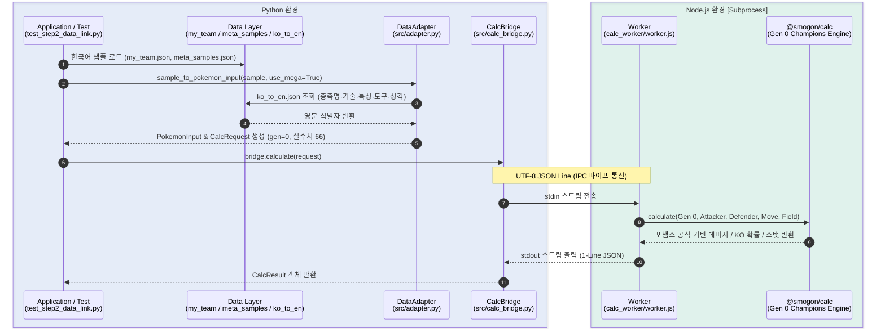

# 포챔스 배틀 어시스턴트 — Step 2: 한영 데이터 링크 및 샘플 기반 계산 가이드

포켓몬 챔피언스(포챔스) 배틀 어시스턴트의 **Step 2: 한글 ↔ 영어 데이터 매핑 구축 및 샘플 기반 데미지 계산**에 관한 전체 구현 과정, 데이터 규격, 아키텍처 및 트러블슈팅 정리 문서입니다.

---

## 1. 개요 (Overview)

사용자가 배틀 파티(`my_team.json`)와 상대 메타 샘플(`meta_samples.json`)을 **순수 한국어**와 **포챔스 전용 실수치 노력치(총합 66 체계)**로 편리하게 작성하면, 어댑터(`DataAdapter`)가 한영 매핑 사전(`ko_to_en.json`)을 통해 `@smogon/calc`의 포챔스 모드(`gen = 0`) 규격으로 자동 변환하여 데미지 및 스피드를 계산하는 데이터 파이프라인을 구축했습니다.

* **한영 매핑 사전 (`data/ko_to_en.json`)**:
  * 포켓몬(`species`): 347종 (기본 포켓몬 + 리전폼 + 공식/포챔스 메가진화 81종 포함)
  * 기술(`moves`): 901개
  * 특성(`abilities`): 310개
  * 도구(`items`): 실전 배틀 도구 401개 (비배틀 아이템 자동 필터링)
* **데이터 어댑터 (`src/adapter.py`)**: 한국어 샘플 ➔ 영문 `PokemonInput` 자동 변환 및 `gimmick.mega` 처리
* **포챔스 스탯 체계 (`gen = 0`)**: 실수치 66 분배($\text{HP} = \text{종족값} + \text{sp} + 75$, $\text{기타} = \lfloor \text{성격보정} \times (\text{종족값} + \text{sp} + 20) \rfloor$)

---

## 2. 데이터 준비 및 사전 구축 (Data Setup Guide)

### 2.1 다국어 원천 CSV 다운로드
PokeAPI의 다국어 CSV 데이터를 `data/csv/` 경로에 다운로드합니다:

```powershell
if (!(Test-Path data/csv)) { New-Item -ItemType Directory -Force -Path data/csv }
curl.exe -o data/csv/move_names.csv https://raw.githubusercontent.com/PokeAPI/pokeapi/master/data/v2/csv/move_names.csv
curl.exe -o data/csv/ability_names.csv https://raw.githubusercontent.com/PokeAPI/pokeapi/master/data/v2/csv/ability_names.csv
curl.exe -o data/csv/item_names.csv https://raw.githubusercontent.com/PokeAPI/pokeapi/master/data/v2/csv/item_names.csv
```

---

### 2.2 한영 사전 동기화 및 실전 도구 필터링
아래 단일 스크립트를 실행하면 CSV에서 한국어(`local_language_id = 3`)와 영어(`local_language_id = 9`)를 추출하여 `data/ko_to_en.json`을 갱신하며, 도구(`items`)는 `@smogon/calc` 화이트리스트와 블랙리스트 필터를 거쳐 실전 배틀 도구만 남깁니다:

```powershell
python scripts/update_ko_to_en.py
```

---

## 3. 시스템 아키텍처 (Architecture)



### 3.1 프로젝트 파일 구조
> `✨ NEW`: Step 2에서 신규 생성된 파일/디렉토리  
> `🔄 UPDATED`: Step 2에서 수정 및 포챔스 규격으로 개편된 파일

```text
pochamps-assistant/
├── .venv/                      # Python 가상환경
├── node_modules/               # Node.js 의존성 패키지
├── calc_worker/
│   └── worker.js               # [🔄 UPDATED] DEFAULT_GEN = 0 (포챔스 모드) 전환
├── data/
│   ├── csv/                    # [✨ NEW] PokeAPI 다국어 원천 데이터 디렉토리
│   │   ├── ability_names.csv   # [✨ NEW] 특성 다국어 원천 CSV
│   │   ├── item_names.csv      # [✨ NEW] 도구 다국어 원천 CSV
│   │   └── move_names.csv      # [✨ NEW] 기술 다국어 원천 CSV
│   ├── ko_to_en.json           # [🔄 UPDATED] 기술·특성·실전도구 대량 동기화 및 347종 검증
│   ├── my_team.json            # [🔄 UPDATED] 한국어 단일 포맷 + 실수치 66 + gimmick.mega 개편
│   └── meta_samples.json       # [🔄 UPDATED] 한국어 단일 포맷 + 실수치 66 + gimmick.mega 개편
├── docs/
│   ├── STEP1_GUIDE.md          # Step 1: 계산 엔진 통합 가이드
│   └── STEP2_GUIDE.md          # [✨ NEW] 본 문서 (Step 2 가이드)
├── scripts/
│   └── update_ko_to_en.py      # [✨ NEW] CSV 파싱 및 실전 배틀 도구 자동 필터링 스크립트
├── src/
│   ├── __init__.py             # 코어 패키지 선언
│   ├── schemas.py              # [🔄 UPDATED] gen=0(포챔스) 기본값 및 StatSpread 66 규격
│   ├── calc_bridge.py          # Python ↔ Node.js IPC 서브프로세스 브릿지
│   └── adapter.py              # [✨ NEW] 한국어 샘플 ➔ 계산기 영문 포맷 변환 어댑터
├── package.json                # Node.js 패키지 정의
├── requirements.txt            # Python 의존성 목록
├── test_step1_calc.py          # [🔄 UPDATED] Step 1 계산 엔진 테스트 (실수치 66 적용)
└── test_step2_data_link.py     # [✨ NEW] Step 2 한영 데이터 링크 및 샘플 계산 통합 테스트
```

### 3.2 샘플 데이터 표준 규격 (`my_team.json` & `meta_samples.json`)
내 파티와 상대 메타 샘플 모두 **동일한 한국어 단일 규격**을 사용합니다.
* **노력치 (`evs`)**: 포챔스 규격인 **실수치 총합 66 (단일 항목 최대 32)**으로 기입합니다.
* **특수 기믹 (`gimmick`)**: 메가진화 시 변경되는 폼(`form`)과 특성(`ability`)을 하위 블록으로 분리하여 배틀 등장 시 특성(예: 위협, 배짱)과 메가진화 후 특성(예: 스카이스킨, 부자유친)을 모두 보존합니다.

```json
{
  "보만다": [
    {
      "name": "보만다",
      "form_desc": "메가진화 물리 용춤형",
      "item": "보만다나이트",
      "ability": "위협",
      "nature": "명랑",
      "evs": {
        "hp": 2,
        "atk": 32,
        "def": 0,
        "spa": 0,
        "spd": 0,
        "spe": 32
      },
      "moves": [
        "이판사판태클",
        "용의춤",
        "지진",
        "날개쉬기"
      ],
      "gimmick": {
        "mega": {
          "form": "메가보만다",
          "ability": "스카이스킨"
        }
      }
    }
  ]
}
```

---

## 4. Step 2 상세 구현 과정

### 4.1 사전 구축 및 도구 필터링 (`scripts/update_ko_to_en.py`)
* `move_names.csv`, `ability_names.csv`, `item_names.csv`에서 한국어-영어 쌍을 추출하여 `data/ko_to_en.json`에 병합합니다.
* **2단계 실전 도구 필터링**:
  1. **1차 화이트리스트**: `@smogon/calc`의 세대별 `ITEMS` 및 `MEGA_STONES`에 존재하는 유효 도구만 추출 (상처약, 해독제, 만병통치제 등 회복/잡화 1,500여 개 차단).
  2. **2차 블랙리스트**: 구세대 스모곤 레거시에 남아있던 포획용 볼류(`Master Ball` 등, 단 실전 도구인 `Light Ball`·`Iron Ball`은 유지), 기술머신/레코드(`TM`/`TR`), 진화의 돌, 화석류를 제거하여 **실전 배틀 도구 401개**만 정제.

### 4.2 포챔스 전용 스탯 계산 모드 (`gen = 0`)
* `@smogon/calc` 내부의 `gen = 0`(`calcStatChampions`) 모드를 기본값으로 활성화했습니다.
* 본가의 510 노력치(실수치 합 65) 대신, 포챔스 고유의 **실수치 66 직접 분배** 공식을 사용하여 인게임 수치와 100% 일치하는 스탯 및 데미지를 산출합니다.

### 4.3 한국어 데이터 어댑터 (`src/adapter.py`)
* `DataAdapter`: `ko_to_en.json` 및 25개 성격 매핑(`NATURE_KO_TO_EN`)을 로드하여 한국어 포켓몬명, 기술, 특성, 도구, 성격을 영문 식별자로 변환합니다.
* `sample_to_pokemon_input(sample, use_mega=True)`:
  * `use_mega=True`일 때 샘플 내 `gimmick.mega`가 존재하면 메가진화 종족명(`form`)과 메가 특성(`ability`)으로 자동 전환하여 `PokemonInput` 객체를 생성합니다.
  * `use_mega=False`일 때는 메가진화 전 기본 종족명과 기본 특성으로 생성되어 턴별/상황별 시뮬레이션을 지원합니다.

---

## 5. 트러블슈팅 이력 (Troubleshooting History)

| 번호 | 증상 | 원인 | 해결 방법 |
| :--- | :--- | :--- | :--- |
| **1** | `킬가르도 (Aegislash)` 검증 시 `Cannot read properties of undefined (reading 'hp')` | `@smogon/calc`에서 킬가르도는 기본 스탯이 폼(`Aegislash-Shield`, `Aegislash-Blade`)에만 정의되어 있음 | 기본 `"킬가르도"`를 실전 등장 폼인 `"Aegislash-Shield"`로 매핑하고 실드폼/블레이드폼 개별 항목 추가 |
| **2** | `메가냐오닉스 (Meowstic-Mega)` 검증 시 `reading 'hp'` 에러 | 포챔스 데이터에서 냐오닉스는 성별에 따라 종족값/특성이 달라 `Meowstic-M-Mega`, `Meowstic-F-Mega`로 구분됨 | `"메가냐오닉스"`를 `"Meowstic-M-Mega"`로 매핑하고 수컷/암컷 메가진화 항목을 각각 분리 등록 |
| **3** | 도구 필터링 후에도 `마스터볼`, `기술레코드(TR)` 등이 남아있음 | `@smogon/calc`의 구세대(2세대/8세대) 데이터셋에 포획용 볼과 TR00~TR99, 화석류가 레거시로 포함됨 | `update_ko_to_en.py` 내에 포획용 볼, TM/TR, 진화의 돌, 화석을 걸러내는 2차 블랙리스트 필터 통합 |
| **4** | `gen = 0`(포챔스 모드) 전환 후 `플라엣테`, `케오퍼스`, `그우린차` 검증 실패 | 1) 포챔스에는 영원의꽃 플라엣테(`Floette-Eternal`)만 존재<br/>2) 케오퍼스(`Grapploct`)와 그우린차(`Sinistcha`)가 진화 전 영문명(`Clobbopus`, `Poltchageist`)으로 오기재됨 | `ko_to_en.json`에서 `"Floette-Eternal"`, `"Grapploct"`, `"Sinistcha"`로 정식 명칭 수정 |

---

## 6. 테스트 및 검증 방법 (Testing)

### 6.1 테스트 스크립트 실행
프로젝트 루트에서 다음 명령어를 실행합니다:

```powershell
# Windows PowerShell
$env:PYTHONIOENCODING = "utf-8"
python test_step2_data_link.py
```

또는 `pytest` 사용 시:
```bash
python -m pytest test_step2_data_link.py -v -s
```

### 6.2 포함된 테스트 케이스 ([`test_step2_data_link.py`](../test_step2_data_link.py))
1. **`test_ko_to_en_pokemon`**:
   * 대상: `data/ko_to_en.json`의 `species` 전체 (347종)
   * 검증: 일반 포켓몬, 리전폼, 공식 및 포챔스 커스텀 메가진화 전 종족이 `gen = 0` 계산 엔진에서 오류 없이 인스턴스화 및 데미지 계산되는지 전수 확인.
2. **`test_sample_data_link`**:
   * 대상: `data/my_team.json`, `data/meta_samples.json`
   * 검증: 샘플에 기입된 모든 한글 이름(포켓몬, 메가폼, 도구, 특성, 성격, 기술 4개)이 사전을 통해 누락 없이 영문으로 매핑되는지 확인.
3. **`test_sample_damage_calc`**:
   * 대진 1: 내 파티 `메가캥카` (공격 32, HP 32, 방어 2) vs 상대 `메가보만다` (공격 32, 스피드 32, HP 2)
   * 대진 2: 내 파티 `메가캥카` vs 상대 `메가리자몽X` (공격 32, 스피드 32, HP 2)
   * 검증: 한글 샘플을 `DataAdapter`로 변환하여 속이기, 이판사판태클, 냉동빔, 기습 각각의 데미지 및 확정/난수타 판정이 정상 출력되는지 확인.
