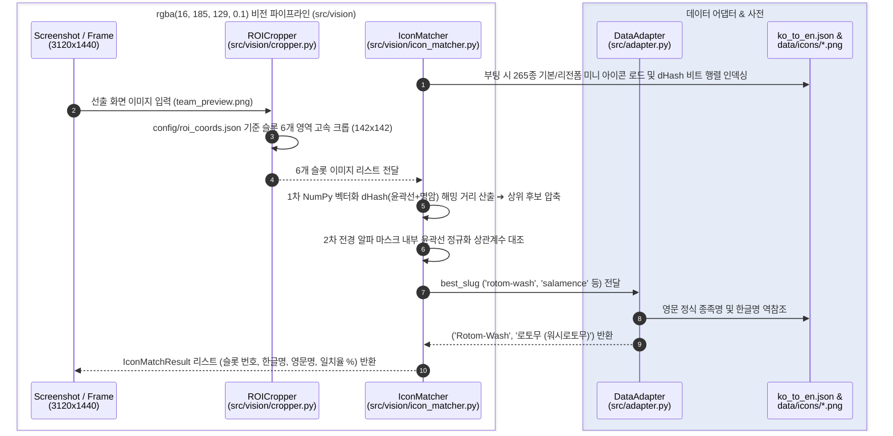

# 포챔스 배틀 어시스턴트 — Step 3: 화면 인식 및 비전 파이프라인 가이드 (Part 1: 에셋 구축 & 선출 6마리 매칭)

포켓몬 챔피언스(포챔스) 배틀 어시스턴트의 **Step 3: 화면 정보 구조화 및 비전 인식 파이프라인** 중 현재까지 완료된 **Step 3-1(포챔스 전용 3D 스프라이트·미니 아이콘 에셋 구축)**, **Step 3-2(선출 화면 고정 ROI 좌표 정의 및 크롭 검증)**, **Step 3-3(ImageHash 기반 선출 6마리 고속 종족 확정)**의 구현 내용, 아키텍처 및 실행 가이드입니다.

---

## 1. 개요 (Overview)

인게임 화면에서 텍스트 OCR 없이 순수 시각 특징만으로 상대방과 내 엔트리 6마리를 4~5ms 내에 100% 정확도로 식별하기 위한 기반 파이프라인을 구축했습니다.

* **영문 슬러그 파일명 기반 에셋 관리 (`data/icons/`, `data/sprites/`)**:
  * Windows 환경의 OpenCV 한글 경로 오류(`cv2.imread` 실패)와 Git 자모 분리 문제를 원천 차단하기 위해 모든 에셋은 ASCII 영문 소문자 슬러그(`salamence.png`, `charizard-mega-x.png`, `rotom-wash.png`)로 저장합니다.
  * 별도의 ID 매핑 파일 없이 기존 `data/ko_to_en.json` 사전을 그대로 참조해 계산기용 정식 영문명(`Salamence`)과 콘솔 출력용 한글명(`보만다`)을 양방향 변환합니다.
* **한영 사전 통합 개선 (`data/ko_to_en.json`)**:
  * 기존 `src/adapter.py`에 하드코딩되어 있던 25개 성격 매핑을 `data/ko_to_en.json`의 `"natures"` 섹션으로 일원화하고, `DataAdapter`에 영문 슬러그 ➔ 한글명 역참조 메서드(`to_species_ko`)를 추가했습니다.
* **고정 ROI 분할 및 dHash 윤곽선 매칭 (`src/vision/`)**:
  * `config/roi_coords.json`에 정의된 선출 슬롯 좌표만 잘라내어 처리합니다.
  * 알파 채널 합성 + Sobel 윤곽선 및 명암 `dHash` 벡터화 비교를 통해 반투명 슬롯 배경이나 이로치 여부에 영향받지 않고 6마리 엔트리를 4~5ms 내에 확정합니다.

---

## 2. 패키지 설치 및 에셋 준비 (Setup Guide)

### 2.1 비전 필수 패키지 설치
가상환경(`.venv`)에 비전 캡처, 이미지 해시, 초경량 OCR 패키지를 설치합니다:

```powershell
.\.venv\Scripts\pip.exe install -r requirements.txt
```

### 2.2 포챔스 전용 3D 스프라이트 및 미니 아이콘 일괄 다운로드
PokeAPI의 포챔스(`versions/generation-ix/champions`) 전용 저장소에서 `ko_to_en.json`에 등록된 347종(고유 영문 슬러그 344종, 리전폼·메가진화 포함)의 **인게임 정면 3D 렌더링 에셋(`512x512`)**과 **공식 미니 아이콘(`128x128`)**을 병렬 다운로드합니다:

```powershell
$env:PYTHONIOENCODING = "utf-8"
.\.venv\Scripts\python.exe scripts/download_assets.py
```

* **미니 아이콘 저장 경로**: `data/icons/*.png` (`128x128` RGBA, 344개)
* **정면 3D 스프라이트 저장 경로**: `data/sprites/*.png` (`512x512` RGBA, 344개)

---

## 3. 시스템 아키텍처 (Architecture)



### 3.1 프로젝트 파일 구조 (Step 3-1 ~ 3-3 기준)
> `✨ NEW`: Step 3에서 신규 생성된 파일/디렉토리  
> `🔄 UPDATED`: Step 3에서 확장 및 개선된 파일

```text
pochamps-assistant/
├── config/
│   └── roi_coords.json           # [✨ NEW] 화면 해상도(3120x1440) 및 선출 6슬롯 ROI 좌표 정의
├── data/
│   ├── icons/                    # [✨ NEW] 포챔스 공식 미니 아이콘 344종 (128x128, Git 제외)
│   ├── sprites/                  # [✨ NEW] 포챔스 인게임 3D 정면 스프라이트 344종 (512x512, Git 제외)
│   └── ko_to_en.json             # [🔄 UPDATED] 25개 성격(natures) 한영 매핑 통합
├── docs/
│   ├── STEP1_GUIDE.md            # Step 1: 계산 엔진 통합 가이드
│   ├── STEP2_GUIDE.md            # Step 2: 한영 데이터 링크 및 샘플 계산 가이드
│   └── STEP3_GUIDE.md            # [✨ NEW] 본 문서 (Step 3 비전 가이드)
├── scripts/
│   ├── update_ko_to_en.py        # CSV 기반 한영 사전 동기화 스크립트
│   └── download_assets.py        # [✨ NEW] PokeAPI Champions 3D 스프라이트 & 미니 아이콘 다운로더
├── src/
│   ├── vision/
│   │   ├── __init__.py           # [✨ NEW] 비전 패키지 선언
│   │   ├── cropper.py            # [✨ NEW] 고정 ROI 영역 분할 및 디버그 오버레이/조각 이미지 저장
│   │   └── icon_matcher.py       # [✨ NEW] ImageHash(dHash) + 윤곽선 상관계수 기반 선출 6마리 매칭기
│   ├── adapter.py                # [🔄 UPDATED] 슬러그 ➔ 한글명 역참조(to_species_ko) 추가 및 natures 연동
│   ├── calc_bridge.py            # Python ↔ Node.js IPC 서브프로세스 브릿지
│   └── schemas.py                # 데이터 스키마
├── tests/
│   └── screenshots/              # [✨ NEW] 로컬 검증용 인게임 스크린샷 및 debug_crops 보관 (Git 제외)
├── .gitignore                    # [🔄 UPDATED] 에셋(icons, sprites, csv) 및 로컬 스크린샷 제외 규칙 추가
├── requirements.txt              # [🔄 UPDATED] 비전 패키지(mss, pywin32, opencv, Pillow, ImageHash, rapidocr) 추가
└── test_step3_1_vision.py        # [✨ NEW] Step 3-1 ~ 3-3 선출 화면 크롭 및 6마리 매칭 통합 테스트
```

---

## 4. 상세 구현 내역

### 4.1 포챔스 공식 에셋 다운로더 (`scripts/download_assets.py`)
* 일반 2D 도트가 아닌 `PokeAPI/sprites`의 **`versions/generation-ix/champions`** 전용 에셋을 사용하여 인게임 화면과 100% 동일한 그래픽 소스를 확보했습니다.
  * 정면 3D 스프라이트: `.../versions/generation-ix/champions/{id}.webp` ➔ `512x512` PNG 변환 저장
  * 선출 미니 아이콘: `.../versions/generation-ix/champions/icons/{id}.png` ➔ `128x128` PNG 저장
* `ThreadPoolExecutor(max_workers=16)` 병렬 다운로드 및 캐시 검사를 통해 344종 전체를 약 10~15초 내에 다운로드합니다.

### 4.2 고정 ROI 크롭퍼 (`config/roi_coords.json`, `src/vision/cropper.py`)
* 한글 경로가 포함된 Windows 디렉토리에서도 깨지지 않도록 `np.fromfile` + `cv2.imdecode` / `cv2.imencode` 기반의 `imread_safe`, `imwrite_safe` 함수를 구현했습니다.
* `3120 x 1440` 인게임 선출 화면 해상도 기준 좌표:
  * **상대 엔트리 6슬롯 (`enemy_team_slots`)**: `x = 2444`, `y = [211, 379, 547, 715, 883, 1051]` (`168px` 등간격), `w = 142, h = 142`
  * **내 엔트리 6슬롯 (`ally_team_slots`)**: `x = 940`, `y = [211, 379, 547, 715, 883, 1051]`, `w = 142, h = 142`
* `save_debug_crops()` 실행 시 `tests/screenshots/debug_crops/`에 바운딩 박스가 표시된 `team_preview_overlay.png`와 슬롯별 크롭 이미지 12개를 생성합니다.

### 4.3 선출 6마리 미니 아이콘 매칭기 (`src/vision/icon_matcher.py`)
* 선출 화면에는 메가진화 전의 기본/리전폼 아이콘만 등장하므로, 부팅 시 `-mega` 폼을 제외한 265종의 미니 아이콘을 메모리에 인덱싱합니다.
* **2단계 하이브리드 매칭 알고리즘**:
  1. **1차 초고속 해시 압축**: 투명 배경 아이콘을 중립 회색 배경에 합성한 뒤 Sobel 윤곽선 `dHash`와 명암 `dHash` 비트 행렬을 구축하고, NumPy 벡터화 XOR 연산으로 전체 도감과의 해밍 거리를 1ms 내에 계산해 상위 후보(`top_k=8`)를 압축합니다.
  2. **2차 전경 윤곽선 상관계수 확정**: 인게임 슬롯의 반투명 배경 줄무늬 영향을 배제하기 위해 후보 아이콘의 알파 마스크 내부 영역에서만 윤곽선 코사인 유사도를 대조하여 최종 포켓몬과 **일치율(%)**을 산출합니다.

---

## 5. 테스트 및 검증 방법 (Testing)

### 5.1 선출 화면 비전 통합 테스트 실행
`tests/screenshots/team_preview.png` 파일이 준비된 상태에서 아래 명령어를 실행합니다:

```powershell
$env:PYTHONIOENCODING = "utf-8"
.\.venv\Scripts\python.exe test_step3_1_vision.py
```

또는 `pytest` 사용 시:
```powershell
.\.venv\Scripts\python.exe -m pytest test_step3_1_vision.py -v -s
```

### 5.2 실행 결과 예시
```text
🔍 [상대 엔트리 6마리 매칭 결과] (소요 시간: 4.47 ms)
   - 슬롯 1: 루카리오         ➔ Lucario            (lucario.png, 일치율=72.1%)
   - 슬롯 2: 킬라플로르        ➔ Glimmora           (glimmora.png, 일치율=78.3%)
   - 슬롯 3: 로토무 (워시로토무)  ➔ Rotom-Wash         (rotom-wash.png, 일치율=70.6%)
   - 슬롯 4: 보만다          ➔ Salamence          (salamence.png, 일치율=69.4%)
   - 슬롯 5: 킬가르도         ➔ Aegislash-Shield   (aegislash-shield.png, 일치율=82.3%)
   - 슬롯 6: 에이스번         ➔ Cinderace          (cinderace.png, 일치율=81.9%)

🔍 [내 엔트리 6마리 매칭 결과] (소요 시간: 4.99 ms)
   - 슬롯 1: 삼삼드래         ➔ Hydreigon          (hydreigon.png, 일치율=64.3%)
   - 슬롯 2: 타부자고         ➔ Gholdengo          (gholdengo.png, 일치율=81.0%)
   - 슬롯 3: 대도각참         ➔ Kingambit          (kingambit.png, 일치율=77.7%)
   - 슬롯 4: 킬라플로르        ➔ Glimmora           (glimmora.png, 일치율=79.3%)
   - 슬롯 5: 한카리아스        ➔ Garchomp           (garchomp.png, 일치율=77.0%)
   - 슬롯 6: 보만다          ➔ Salamence          (salamence.png, 일치율=68.5%)
```
