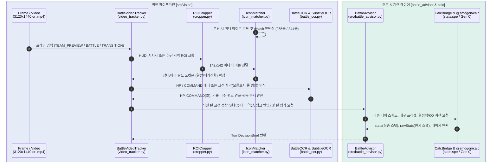

# 포챔스 배틀 어시스턴트 — Step 3: 화면 인식, 비전 파이프라인 및 배틀 어드바이저 가이드

포켓몬 챔피언스(포챔스) 배틀 어시스턴트의 **Step 3: 화면 정보 구조화, 비전 인식 파이프라인 및 시계열 상태 역추론 어드바이저**에 관한 전체 구현 과정, 에셋 세팅, 아키텍처 및 트러블슈팅 정리 문서입니다.

---

## 1. 개요 (Overview)

인게임 파티 정보 화면, 선출 화면, 배틀 화면(정지 스크린샷), 그리고 실제 배틀 녹화 영상(`.mp4`)에서 2D 미니 아이콘 시각 매칭과 초경량 배치 CRNN / 한국어 PP-OCRv4 인식을 결합하여 다음 정보를 실시간으로 구조화합니다:
1. **내 파티 스크린샷 OCR (`src/vision/party_ocr.py`)**: 파티 기술/도구 및 스탯/노력치 스크린샷에서 한글 자모 분해 유사도(`jamo_similarity`) 교정을 통해 6마리 스펙을 파싱해 `data/my_team.json` (`team1`) 자동 생성
2. **선출 화면 (6v6 엔트리)**: 상대방 6마리와 내 엔트리 6마리 종족 확정 (일반 폼 265종 인덱스 기반)
3. **배틀 정지 화면 (HUD & OCR)**: 필드 위 아군/상대 포켓몬(일반·메가진화 344종), 상대 체력(%), 아군 체력(현재/최대 및 %), 우측 상단 COMMAND 타이머 판별 (교체 메뉴로 HUD가 가려진 커맨드 상태 포함)
4. **배틀 중 하단 자막 고속 OCR (`BattleSubtitleOCR`)**: 교전 중 기술 선언(`스케일샷`, `드래곤테일` 등), 다단히트 타수(`2번 맞았다!`), 랭크 변화(`스피드가 올라갔다!`)를 모폴로지 줄 병합 + CRNN 직접 배치 호출로 고속 파싱
5. **실시간 배틀 어드바이저 & 역추론 엔진 (`src/battle_advisor.py`)**:
   * **다중 스피드 티어 비교**: 상대 스펙 미확정 시 `최속(S32+)`, `준속(S32)`, `무투자(S0)`, `최속 스카프 참고치`를 동시 비교 (`@smogon/calc` 의 `stats.spe` 단일 원천 활용)
   * **실전 선후공 역추론 (`record_turn_order`)**: 동일 우선도 교전에서 아군이 선공 시 상대 스피드 상한 및 스카프 후보 자동 배제
   * **내구 범위 Bayesian 역추론 (`infer_enemy_bulk`)**: 아군 공격 기술·타수 및 상대 체력 감소(%)로 `H2 B0` ~ `H32 B32+` 내구 범위를 교집합으로 좁혀 다음 턴 결정력에 반영
   * **기믹/도구/특성 추적**: `가속` 턴별 랭크업, 메가진화 도구·특성 확정, `기합의띠` 발동·소모 추적

* **포챔스 전용 비전 에셋 (`data/icons/`, `data/sprites/`)**:
  * 공식 2D 미니 아이콘(`data/icons/*.png`): `128x128` RGBA, 344종 (비전 매칭 필수 에셋)
  * 인게임 정면 3D 스프라이트(`data/sprites/*.png`): `512x512` RGBA, 344종 (향후 GUI 대시보드 일러스트용 선택 에셋)
  * 모든 에셋은 영문 소문자 슬러그(`salamence.png`, `gyarados-mega.png` 등)로 저장하며 `DataAdapter`를 통해 정식 영문명·한글명과 양방향 연동됩니다.
* **선출 & 배틀 HUD 단일 아이콘 매칭 아키텍처 (`src/vision/icon_matcher.py`)**:
  * 선출 슬롯(`142x142`)뿐만 아니라 **배틀 상태창 좌/우측에도 동일한 크기(`142x142`)의 2D 미니 아이콘**이 고정 표시되며, 메가진화 시 즉시 메가진화 아이콘(`gyarados-mega.png` 등)으로 갱신됩니다.
  * 따라서 카메라 앵글이 수시로 바뀌는 3D 필드 모델을 비교할 필요 없이, **HUD 미니 아이콘 매칭 하나로 일반 폼과 메가진화 폼을 2~4ms 내에 100% 확정**합니다.
* **초경량 배치 CRNN 체력 & 자막 OCR (`src/vision/battle_ocr.py`)**:
  * 고정 ROI 3개(`enemy_hp_text`, `ally_hp_text`, `command_banner`)를 단일 배치 CRNN 호출로 처리하고, `CONMAND44`/`ND44`/`C45` 등 오인식 구제 퍼지 매칭을 지원합니다.
  * 교전 중 자막은 흰색 마스크 + 가로 모폴로지 병합(`50x4`)으로 줄 박스만 잘라 DBNet 없이 `KoreanOCR.text_recognizer`를 직접 호출합니다.
* **배틀 녹화 영상 시계열 비전 추적기 (`src/vision/video_tracker.py`)**:
  * `TEAM_PREVIEW` 감지 시 6v6 엔트리를 자동 잠금하고, 해당 6마리의 일반 폼 + 메가진화 후보군 내에서 배틀 HUD를 교차 검증하며 각 턴(`BATTLE_COMMAND`)과 교전 정산(`_finalize_pending_turn`)을 수행합니다.

---

## 2. 패키지 설치 및 에셋 준비 (Setup Guide)

### 2.1 비전 필수 패키지 설치
가상환경(`.venv`)이 활성화된 상태에서 비전 캡처, 이미지 해시, 초경량 OCR 패키지를 설치합니다:

```powershell
pip install -r requirements.txt
```

설치되는 주요 비전 의존성:
* `opencv-python-headless`, `numpy`, `Pillow`: 이미지 정규화, ROI 크롭 및 알파 채널 전처리
* `ImageHash`: 윤곽선 및 명암 `dHash` 고속 계산
* `rapidocr-onnxruntime`: 체력(HP) 및 커맨드 배너 초경량 CRNN 텍스트 OCR
* `mss`, `pywin32`: 실시간 윈도우 화면 캡처

---

### 2.2 포챔스 전용 미니 아이콘 및 3D 스프라이트 다운로드
PokeAPI의 포챔스(`versions/generation-ix/champions`) 전용 저장소에서 `ko_to_en.json`에 등록된 347종(고유 영문 슬러그 344종, 리전폼·메가진화 포함)의 에셋을 병렬 다운로드합니다:

```powershell
# [필수] 비전 매칭용 공식 2D 미니 아이콘 다운로드 (data/icons/*.png, 128x128 RGBA, 344개)
python scripts/download_icons.py

# [선택] 향후 GUI 대시보드 일러스트용 3D 정면 스프라이트 다운로드 (data/sprites/*.png, 512x512 RGBA, 344개)
python scripts/download_sprites.py
```

---

## 3. 시스템 아키텍처 (Architecture)



### 3.1 프로젝트 파일 구조
> `✨ NEW`: Step 3에서 신규 생성된 파일/디렉토리  
> `🔄 UPDATED`: Step 3에서 확장 및 개선된 파일

```text
pochamps-assistant/
├── .venv/                        # Python 가상환경
├── node_modules/                 # Node.js 의존성 패키지
├── calc_worker/
│   └── worker.js                 # Node.js @smogon/calc 래퍼 워커 (Gen 0 포챔스 모드)
├── config/
│   └── roi_coords.json           # [✨ NEW] 기준 해상도(3120x1440), 선출 12슬롯, 페이즈 지시자, 배틀 HUD/HP ROI 정의
├── data/
│   ├── csv/                      # PokeAPI 다국어 원천 CSV 디렉토리
│   ├── icons/                    # [✨ NEW] 포챔스 공식 미니 아이콘 344종 (128x128, Git 제외)
│   ├── sprites/                  # [✨ NEW] 포챔스 인게임 3D 정면 스프라이트 344종 (512x512, GUI용, Git 제외)
│   ├── models/                   # [✨ NEW] 한국어 PP-OCRv4 모델 및 사전 (korean_PP-OCRv4_rec_infer.onnx)
│   ├── ko_to_en.json             # 한국어 ↔ 영어 매핑 사전 (포켓몬·기술·특성·도구·성격)
│   └── my_team.json              # 내 팀 포켓몬 파티(team1) 정보
├── docs/
│   ├── STEP1_GUIDE.md            # Step 1: 계산 엔진 통합 가이드
│   ├── STEP2_GUIDE.md            # Step 2: 한영 데이터 링크 및 파티 스펙 가이드
│   └── STEP3_GUIDE.md            # [✨ NEW] 본 문서 (Step 3 비전 파이프라인 가이드)
├── scripts/
│   ├── update_ko_to_en.py        # CSV 파싱 및 실전 배틀 도구 자동 필터링 스크립트
│   ├── download_icons.py         # [✨ NEW] PokeAPI Champions 공식 2D 미니 아이콘 다운로더 (필수)
│   └── download_sprites.py       # [✨ NEW] PokeAPI Champions 3D 정면 스프라이트 다운로더 (선택/GUI용)
├── src/
│   ├── vision/
│   │   ├── __init__.py           # [✨ NEW] 비전 패키지 선언
│   │   ├── cropper.py            # [✨ NEW] 선출/배틀/자막 ROI 분할 및 부분 비례 크롭퍼
│   │   ├── icon_matcher.py       # [✨ NEW] ImageHash(dHash) + 윤곽선 상관계수 기반 아이콘 매칭기 (일반/메가진화/후보군 필터)
│   │   ├── phase_detector.py     # [✨ NEW] 게임 화면 페이즈(GamePhase) 열거형 및 결과 정의
│   │   ├── party_ocr.py          # [✨ NEW] 한국어 PP-OCRv4 + 자모 유사도 기반 내 파티 스크린샷 파서
│   │   ├── battle_ocr.py         # [✨ NEW] 체력/커맨드 배너 배치 CRNN + 교전 하단 자막 고속 OCR(BattleSubtitleOCR)
│   │   └── video_tracker.py      # [✨ NEW] 선출 잠금, 교체 창 커맨드 보존, 자막/역추론 연동 시계열 추적기
│   ├── __init__.py               # 코어 패키지 선언
│   ├── schemas.py                # 요청/응답 데이터 스키마
│   ├── calc_bridge.py            # Python ↔ Node.js IPC 서브프로세스 브릿지
│   ├── adapter.py                # [🔄 UPDATED] 슬러그 ↔ 영문명·한글명 역참조(to_species_en / to_species_ko) 연동
│   └── battle_advisor.py         # [✨ NEW] 다중 스피드 티어, 선후공·내구 역추론, 랭크/도구 추적 어드바이저
├── tests/
│   ├── screenshots/              # [✨ NEW] 기준 스크린샷(team_preview*, team_moves_items, team_stats_evs, battle_*) 및 debug_crops
│   └── battle_play*.mp4          # [✨ NEW] 인게임 실전 배틀 녹화 영상 (Git 제외)
├── .gitignore                    # [🔄 UPDATED] 에셋(icons, sprites, csv), 녹화 영상(*.mp4), debug_crops 제외 규칙 추가
├── package.json                  # Node.js 패키지 정의
├── requirements.txt              # [🔄 UPDATED] 비전 패키지(mss, pywin32, opencv, Pillow, ImageHash, rapidocr) 추가
├── test_step1_calc.py            # Step 1 계산 엔진 통합 테스트
├── test_step2_data_link.py       # Step 2 한영 데이터 링크 및 파티 계산 통합 테스트
├── test_party_ocr.py             # [✨ NEW] 내 파티 스크린샷 한국어 OCR 및 my_team.json 갱신 검증 테스트
├── test_step3_1_vision.py        # [✨ NEW] Step 3-1 선출 정지 화면 (ROI 크롭 & 6v6 아이콘 매칭) 테스트
├── test_step3_2_vision.py        # [✨ NEW] Step 3-2 배틀 정지 화면 (ROI 크롭, HUD 아이콘 매칭 & HP/커맨드 OCR) 테스트
├── test_battle_state.py          # [✨ NEW] 배틀 상태 추적(가속/랭크/메가진화/다중 티어·내구 역추론) 단위 테스트
└── test_step3_3_vision.py        # [✨ NEW] Step 3-3 배틀 녹화 영상 (.mp4 시계열 전 구간 자동 추적 & 브리핑) 테스트
```

---

## 4. 트러블슈팅 이력 (Troubleshooting History)

| 번호 | 증상 | 원인 | 해결 방법 |
| :--- | :--- | :--- | :--- |
| **1** | Windows 한글 폴더 경로에서 `cv2.imread` / `cv2.imwrite` 실패 및 `None` 반환 | OpenCV C++ 백엔드가 Windows 환경에서 비ASCII(한글) 경로 및 파일명을 처리하지 못함 | 모든 에셋 파일명을 ASCII 영문 소문자 슬러그(`salamence.png` 등)로 통일하고 `np.fromfile` + `cv2.imdecode` 기반 `imread_safe` / `imwrite_safe` 구현 |
| **2** | PokeAPI 조회 시 일부 리전폼·성별폼·신규 메가진화 종족 ID 매핑 실패 (`KeyError`) | `ko_to_en.json`의 쇼다운 규격 영문명과 PokeAPI 슬러그 명명 규칙이 다름 | `download_icons.py`에 `POKEAPI_SLUG_ALIASES` 별칭 사전을 정의하고 신규 메가진화는 기본 종족 ID(`base_id`)로 폴백 처리 |
| **3** | 인게임 선출 슬롯의 반투명 배경색(파랑/분홍) 및 줄무늬로 인해 단순 `dHash` 유사도 저하 | 투명 PNG 원본과 인게임 배경 합성 이미지 간 외곽 경계 명암 대비가 달라짐 | 에셋 인덱싱 시 인게임 슬롯 평균 밝기(`NEUTRAL_BG_GRAY = 105`)로 알파 블렌딩 후, 1차 `dHash` 압축 + 2차 전경 알파 마스크 내부 Sobel 윤곽선 코사인 유사도 결합 |
| **4** | 배틀 필드 3D 포켓몬 모델 매칭 시 카메라 구도 변화 및 이펙트 가림으로 인식 불안정 | 배틀 중 카메라 연출이 수시로 바뀌고 기술 이펙트가 3D 모델을 가림 | 배틀 상·하단 상태창(HUD)에 선출 화면과 동일한 `142x142` 공식 미니 아이콘(메가진화 시 메가 아이콘으로 즉시 전환)이 고정 표시됨을 확인하여 HUD 아이콘 매칭으로 일원화 |
| **5** | Mermaid 시퀀스 다이어그램에서 `box rgba(...)` 배경색이 렌더링되지 않고 텍스트로 노출 | Mermaid 내부 파서(`sequenceDb.ts`의 `parseBoxData`) 정규식이 괄호를 탐욕 매칭(`\(.*\)`)하여 라벨 뒤 소괄호 `( )`까지 색상 토큰으로 삼켜버림 | Mermaid 다이어그램 라벨의 소괄호 `( )`를 대괄호 `[ ]`로 변경하여 색상 토큰과 라벨 텍스트를 정상 분리 |
| **6** | 단일 라인 숫자 OCR 시 검출기(DBNet) 오탐 및 처리 속도 저하 | 이미 고정 좌표로 크롭된 단일 라인 텍스트 영역에 풀 박스 검출기를 돌려 작은 숫자나 `%` 기호가 누락되거나 지연 발생 | `use_text_det=False`로 비활성화하고 3개 영역(`enemy_hp_text`, `ally_hp_text`, `command_banner`)을 단일 배치(Batch)로 CRNN 인식기만 호출하도록 최적화 |
| **7** | 다단히트 기술(`스케일샷`) 보유 포켓몬 브리핑 누락 & 변화기에 `0~0` 데미지 출력 | 다단히트 기술은 `@smogon/calc`의 `damage`가 2D 리스트로 반환되어 `int()` 형변환 시 `TypeError` 발생, 변화기 구분 없이 데미지 계산 | `move.category === 'Status'` 시 변화기 목록으로 분리하고, `_parse_damage_range()`로 2차원 다단히트 난수 배열 합산 처리 |
| **8** | 빠른 입력/교체 창(`포켓몬` 메뉴) 및 `CONMAND44` 등 OCR 오타 시 커맨드 턴 누락 | 교체 메뉴 진입 시 좌·우측 HUD 아이콘이 가려져 `TRANSITION`으로 떨어지거나 배너 OCR 오타가 정규식에 탈락 | `parse_command_banner_text` 퍼지/부분 매칭(`CONMAND`/`ND44`/`C45`) 및 흰색 마스크 폴백 추가 + 활성 배틀 중 `COMMAND` 배너 감지 시 턴 보존 |
| **9** | 배틀 자막 인식 시 배경 이펙트 간섭 및 DBNet 호출로 인한 프레임 처리 지연 | 경기장 조명·파란 랭크다운 이펙트로 아랫줄 글자가 누락되거나 매 프레임 DBNet 호출로 지연 발생 | 순백색 HSV 마스크(`V≥210, S≤50`) + 가로 모폴로지 병합(`50x4`)으로 텍스트 줄 박스만 추출하여 DBNet 없이 `KoreanOCR.text_recognizer` 직접 배치 호출 |

---

## 5. 테스트 및 검증 방법 (Testing)

각 Step은 상호 중복 없이 완전히 분리된 역할을 수행합니다:
* **파티 OCR ([`test_party_ocr.py`](../test_party_ocr.py))**: 내 파티 기술·스탯 스크린샷 한국어 PP-OCRv4 파싱 및 `data/my_team.json` 무결성 검증
* **Step 3-1 ([`test_step3_1_vision.py`](../test_step3_1_vision.py))**: 선출 정지 화면 검증 (선출 ROI 크롭 + 6v6 아이콘 매칭)
* **Step 3-2 ([`test_step3_2_vision.py`](../test_step3_2_vision.py))**: 배틀 정지 화면 검증 (배틀 ROI 크롭 + HUD 아이콘 매칭 + HP/커맨드 OCR)
* **배틀 상태 엔진 ([`test_battle_state.py`](../test_battle_state.py))**: 가속 랭크업·선후공 역전, 메가진화 도구/특성 확정, 기합의띠 소모, 다중 스피드 티어·선공 역추론·내구 역산 단위 테스트
* **Step 3-3 ([`test_step3_3_vision.py`](../test_step3_3_vision.py))**: 배틀 녹화 영상 검증 (`.mp4` 전 구간 시계열 상태 추적 + 실시간 의사결정 브리핑)

### 5.1 테스트 스크립트 실행
프로젝트 루트에서 다음 명령어를 실행합니다:

```powershell
# Windows PowerShell
$env:PYTHONIOENCODING = "utf-8"

# 1. 내 파티 스크린샷 한국어 OCR 테스트
python test_party_ocr.py

# 2. Step 3-1: 선출 화면 테스트 (기본 이미지 또는 경로 지정)
python test_step3_1_vision.py
python test_step3_1_vision.py tests/screenshots/team_preview.png

# 3. Step 3-2: 배틀 정지 화면 테스트 (ROI 크롭, HUD 매칭, HP/COMMAND OCR)
python test_step3_2_vision.py
python test_step3_2_vision.py tests/screenshots/battle_mega.png

# 4. 배틀 상태 추적 & 역추론 엔진 단위 테스트
python test_battle_state.py

# 5. Step 3-3: 배틀 녹화 영상 시계열 추적 테스트 (.mp4)
python test_step3_3_vision.py
python test_step3_3_vision.py tests/battle_play_v4.mp4
```

### 5.2 실행 결과 예시

#### Step 3-2 배틀 정지 화면 검증 (`battle_command.png` & `battle_mega.png`)
```text
📌 battle_command.png (원본: 2340x1080, 소요: 446.8ms)
   - ROI 크롭  : 배틀 4개 + 지시자 6개 영역 검증 완료 (디버그 10개 파일 저장)
   - 상대 필드 : 번치코 (Blaziken, 80.0%) | HP   9% (OCR='9%')
   - 아군 필드 : 한카리아스 (Garchomp, 77.8%) | HP 185/185 (100.0%, OCR='185/185')
   - 커맨드배너 : ✅ COMMAND 45s (신뢰도=0.791, 원본='COMMAND 45')

📌 battle_mega.png (원본: 2340x1080, 소요: 368.1ms)
   - ROI 크롭  : 배틀 4개 + 지시자 6개 영역 검증 완료 (디버그 10개 파일 저장)
   - 상대 필드 : 메가갸라도스 [🔥메가] (Gyarados-Mega, 80.1%) | HP  31% (OCR='31%')
   - 아군 필드 : 아머까오 (Corviknight, 84.5%) | HP 131/205 (63.9%, OCR='131/205')
   - 커맨드배너 : ✅ COMMAND 44s (신뢰도=0.865, 원본='COMMAND44')
```

#### Step 3-3 배틀 녹화 영상 시계열 추적 & 역추론 (`battle_play_v4.mp4`, 232.8초)
```text
🔍 [선출 6v6 자동 잠금 |  0.0s 감지]
   - 상대 엔트리: 마스카나(73%), 밀로틱(62%), 핫삼(52%), 리자몽(68%), 배바닐라(80%), 한카리아스(66%)
   - 아군 엔트리: 아머까오(84%), 타부자고(80%), 마스카나(74%), 킬라플로르(76%), 한카리아스(75%), 팬텀(78%)

⚔️ [Turn  1 |  36.3s | COMMAND 44s] 아군: 한카리아스 (185/185, 100.0%) vs 상대: 한카리아스 (HP 100%)
   📊 [실시간 의사결정 브리핑 | 유동 ⚖️ (아군 154 vs 최속 169[후공🐢] / 준속 154[동속🎲] / S0 122[선공🏃] | 스카프 253)]
      - 지진 / 스케일샷 / 암석봉인 데미지 & 보유 변화기(스텔스록) 표시

⚔️ [Turn  2 |  60.5s | COMMAND 45s] 아군: 한카리아스 (185/185, 100.0%) vs 상대: 한카리아스 (HP  60%)
   📊 [실시간 의사결정 브리핑 | 선공 🏃 (아군 231 [+1랭크] vs 상대 ≤154 [최속·스카프 배제 ✅])]
      📈 [아군 현재 랭크]: 방어 -1, 스피드 +1
      🔍 [상대 정보 분석]: 내구 역산: H32 B32 ~ H32 B32+ (스케일샷 2타 40% 피해)
      - 역추론된 내구(HP 215, Def 147) 기준으로 지진/스케일샷/암석봉인 데미지 재계산

⚔️ [Turn  3 |  93.7s | COMMAND 45s] 아군: 마스카나 (133/151,  88.1%) vs 상대: 한카리아스 (HP  10%)
⚔️ [Turn  4 | 127.0s | COMMAND 45s] 아군: 마스카나 (118/151,  78.1%) vs 상대: 리자몽 (HP 100%)
⚔️ [Turn  5 | 171.4s | COMMAND 45s] 아군: 마스카나 (100/151,  66.2%) vs 상대: 메가리자몽Y [🔥메가] (HP 100%)
   🔍 [상대 정보 분석]: 도구: 리자몽Y나이트 (확정 🔥)
⚔️ [Turn  6 | 199.6s | COMMAND 45s] 아군: 마스카나 ( 85/151,  56.3%) vs 상대: 밀로틱 (HP 100%)

🎬 [분석 완료 요약]
   - 영상 길이: 232.8초 (30.76 FPS) | 분석 프레임: 231개 (1.0초 간격)
   - 감지 결과: 선출 6v6 확정, 총 6개 커맨드 턴, 7건 상태 이벤트
```
