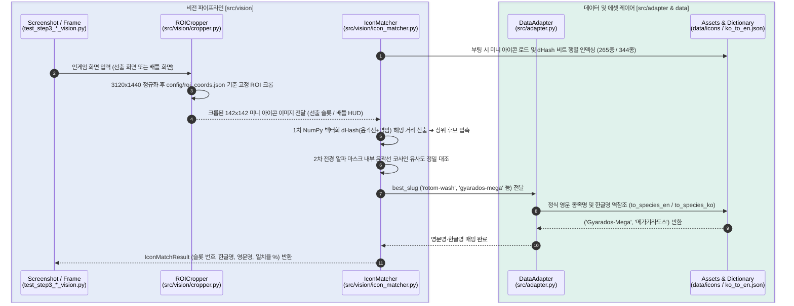

# 포챔스 배틀 어시스턴트 — Step 3: 화면 인식 및 비전 파이프라인 가이드

포켓몬 챔피언스(포챔스) 배틀 어시스턴트의 **Step 3: 화면 정보 구조화 및 비전 인식 파이프라인 (Part 1~2: 선출 & 배틀 ROI·HUD 매칭)**에 관한 전체 구현 과정, 에셋 세팅, 아키텍처 및 트러블슈팅 정리 문서입니다.

---

## 1. 개요 (Overview)

인게임 선출 화면과 배틀 화면에서 텍스트 OCR 없이 순수 시각 특징(고정 미니 아이콘)만으로 선출 6마리 엔트리와 현재 필드에 나와 있는 아군/상대 포켓몬(메가진화 폼 포함)을 수 밀리초(2~5ms) 내에 식별하는 비전 인식 파이프라인을 구축했습니다.

* **포챔스 전용 비전 에셋 (`data/icons/`, `data/sprites/`)**:
  * 공식 2D 미니 아이콘(`data/icons/*.png`): `128x128` RGBA, 344종 (비전 매칭 필수 에셋)
  * 인게임 정면 3D 스프라이트(`data/sprites/*.png`): `512x512` RGBA, 344종 (향후 GUI 대시보드 일러스트용 선택 에셋)
  * 모든 에셋은 영문 소문자 슬러그(`salamence.png`, `gyarados-mega.png` 등)로 저장하며 `DataAdapter`를 통해 정식 영문명·한글명과 양방향 연동됩니다.
* **해상도 자동 정규화 및 고정 ROI 크롭퍼 (`config/roi_coords.json`, `src/vision/cropper.py`)**: 임의의 20:9 입력 프레임을 기준 해상도(`3120x1440`)로 정규화한 뒤 선출 12슬롯, 배틀 HUD 아이콘, 체력(HP) 텍스트, 페이즈 지시자 영역을 분할
* **선출 & 배틀 HUD 단일 아이콘 매칭기 (`src/vision/icon_matcher.py`)**: Sobel 윤곽선·명암 `dHash` 벡터화 비교 및 전경 알파 마스크 코사인 유사도 2단계 매칭으로 선출 엔트리(기본폼 265종)와 배틀 HUD 포켓몬(메가진화 포함 344종)을 초고속 확정

---

## 2. 패키지 설치 및 에셋 준비 (Setup Guide)

### 2.1 비전 필수 패키지 설치
가상환경(`.venv`)이 활성화된 상태에서 비전 캡처, 이미지 해시, 초경량 OCR 패키지를 설치합니다:

```powershell
pip install -r requirements.txt
```

설치되는 주요 비전 의존성:
* `opencv-python`, `numpy`, `Pillow`: 이미지 정규화, ROI 크롭 및 알파 채널 전처리
* `ImageHash`: 윤곽선 및 명암 `dHash` 고속 계산
* `mss`, `pywin32`, `rapidocr-onnxruntime`: 화면 캡처 및 향후 체력/텍스트 OCR 확장용

---

### 2.2 포챔스 전용 미니 아이콘 및 3D 스프라이트 다운로드
PokeAPI의 포챔스(`versions/generation-ix/champions`) 전용 저장소에서 `ko_to_en.json`에 등록된 347종(고유 영문 슬러그 344종, 리전폼·메가진화 포함)의 에셋을 병렬 다운로드합니다:

```powershell
# [필수] 비전 매칭용 공식 2D 미니 아이콘 다운로드 (data/icons/*.png, 128x128 RGBA, 344개)
python scripts/download_icons.py

# [선택] 향후 GUI 대시보드 일러스트용 3D 정면 스프라이트 다운로드 (data/sprites/*.png, 512x512 RGBA, 344개)
python scripts/download_sprites.py
```

---

## 3. 시스템 아키텍처 (Architecture)



### 3.1 프로젝트 파일 구조
> `✨ NEW`: Step 3에서 신규 생성된 파일/디렉토리  
> `🔄 UPDATED`: Step 3에서 확장 및 개선된 파일

```text
pochamps-assistant/
├── .venv/                        # Python 가상환경
├── node_modules/                 # Node.js 의존성 패키지
├── calc_worker/
│   └── worker.js                 # Node.js @smogon/calc 래퍼 워커 (Gen 0 포챔스 모드)
├── config/
│   └── roi_coords.json           # [✨ NEW] 기준 해상도(3120x1440), 선출 12슬롯, 페이즈 지시자, 배틀 HUD/HP ROI 정의
├── data/
│   ├── csv/                      # PokeAPI 다국어 원천 CSV 디렉토리
│   ├── icons/                    # [✨ NEW] 포챔스 공식 미니 아이콘 344종 (128x128, Git 제외)
│   ├── sprites/                  # [✨ NEW] 포챔스 인게임 3D 정면 스프라이트 344종 (512x512, GUI용, Git 제외)
│   ├── ko_to_en.json             # 한국어 ↔ 영어 매핑 사전 (포켓몬·기술·특성·도구·성격)
│   ├── my_team.json              # 내 팀 포켓몬 샘플 정보
│   └── meta_samples.json         # 상대 메타 포켓몬 샘플 세트
├── docs/
│   ├── STEP1_GUIDE.md            # Step 1: 계산 엔진 통합 가이드
│   ├── STEP2_GUIDE.md            # Step 2: 한영 데이터 링크 및 샘플 기반 계산 가이드
│   └── STEP3_GUIDE.md            # [✨ NEW] 본 문서 (Step 3 비전 파이프라인 가이드)
├── scripts/
│   ├── update_ko_to_en.py        # CSV 파싱 및 실전 배틀 도구 자동 필터링 스크립트
│   ├── download_icons.py         # [✨ NEW] PokeAPI Champions 공식 2D 미니 아이콘 다운로더 (필수)
│   └── download_sprites.py       # [✨ NEW] PokeAPI Champions 3D 정면 스프라이트 다운로더 (선택/GUI용)
├── src/
│   ├── vision/
│   │   ├── __init__.py           # [✨ NEW] 비전 패키지 선언
│   │   ├── cropper.py            # [✨ NEW] 선출/배틀 고정 ROI 분할 및 디버그 오버레이/조각 이미지 저장
│   │   └── icon_matcher.py       # [✨ NEW] ImageHash(dHash) + 윤곽선 상관계수 기반 아이콘 매칭기 (일반/메가진화 지원)
│   ├── __init__.py               # 코어 패키지 선언
│   ├── schemas.py                # 요청/응답 데이터 스키마
│   ├── calc_bridge.py            # Python ↔ Node.js IPC 서브프로세스 브릿지
│   └── adapter.py                # [🔄 UPDATED] 슬러그 ↔ 영문명·한글명 역참조(to_species_en / to_species_ko) 연동
├── tests/
│   └── screenshots/              # [✨ NEW] 기준 스크린샷(team_preview*, battle_command, battle_mega) 및 debug_crops
├── .gitignore                    # [🔄 UPDATED] 에셋(icons, sprites, csv), 녹화 영상(*.mp4), debug_crops 제외 규칙 추가
├── package.json                  # Node.js 패키지 정의
├── requirements.txt              # [🔄 UPDATED] 비전 패키지(mss, pywin32, opencv, Pillow, ImageHash, rapidocr) 추가
├── test_step1_calc.py            # Step 1 계산 엔진 통합 테스트
├── test_step2_data_link.py       # Step 2 한영 데이터 링크 및 샘플 계산 통합 테스트
├── test_step3_1_vision.py        # [✨ NEW] Step 3-1 선출 화면 ROI 크롭 및 6마리 아이콘 매칭 범용 테스트
└── test_step3_2_vision.py        # [✨ NEW] Step 3-2 배틀 화면 ROI 크롭 및 배틀 HUD 아이콘(메가진화 포함) 매칭 테스트
```

### 3.2 고정 ROI 좌표 규격 (`config/roi_coords.json`)
기준 해상도(`3120x1440`)를 기준으로 선출 화면 슬롯, 배틀 상태창(HUD) 및 페이즈 판별용 지시자 좌표를 관리합니다.
* **선출 화면 슬롯 (`enemy_team_slots`, `ally_team_slots`)**: 상대(`x = 2444`) 및 아군(`x = 940`) 각 6개 슬롯(`142x142`, `y` 간격 `168px`)
* **배틀 화면 핵심 ROI (`battle_rois`)**: 상단 상대 HUD 아이콘(`enemy_hud_icon`, `142x142`), 상대 체력 `%` 텍스트(`enemy_hp_text`), 하단 아군 HUD 아이콘(`ally_hud_icon`, `142x142`), 아군 체력 `현재/최대` 텍스트(`ally_hp_text`)
* **화면 페이즈 판별 지시자 (`phase_indicators`)**: 선출 배너(`team_preview_banner`), 커맨드 배너(`command_banner`), 기술 버튼 1~4(`move_button_1` ~ `move_button_4`)

---

## 4. Step 3 상세 구현 과정

### 4.1 포챔스 공식 에셋 다운로더 (`scripts/download_icons.py`, `scripts/download_sprites.py`)
* 일반 2D 도트가 아닌 `PokeAPI/sprites`의 **`versions/generation-ix/champions`** 전용 에셋을 사용하며, 비전 필수 에셋과 향후 GUI 선택 에셋을 별도 스크립트로 분리했습니다.
  * **미니 아이콘 다운로더 (`scripts/download_icons.py`, 필수)**: `.../versions/generation-ix/champions/icons/{id}.png` ➔ `128x128` PNG 저장 (`data/icons/`)
  * **정면 3D 스프라이트 다운로더 (`scripts/download_sprites.py`, 선택)**: `.../versions/generation-ix/champions/{id}.webp` ➔ `512x512` PNG 변환 저장 (`data/sprites/`, 향후 GUI 대시보드 확장용)
* `ThreadPoolExecutor(max_workers=16)` 병렬 다운로드 및 캐시 검사를 통해 344종 전체를 약 5~10초 내에 다운로드합니다.

### 4.2 선출 및 배틀 화면 고정 ROI 크롭퍼 (`config/roi_coords.json`, `src/vision/cropper.py`)
* 한글 경로가 포함된 Windows 디렉토리에서도 안전하게 동작하도록 `np.fromfile` + `cv2.imdecode` / `cv2.imencode` 기반의 `imread_safe`, `imwrite_safe` 함수를 구현했습니다.
* 입력 이미지가 `2340x1080` 등 어떤 해상도이든 `normalize_frame()`을 통해 기준 해상도(`3120x1440`)로 자동 변환한 뒤 고정 좌표를 잘라냅니다.
* `save_debug_crops(frame, output_dir, prefix, mode)`를 통해 `mode="preview"`(선출 12슬롯 + 오버레이 = 13개) 및 `mode="battle"`(배틀 ROI 4개 + 배틀 지시자 5개 + 오버레이 = 10개) 검증 이미지를 `tests/screenshots/debug_crops/`에 자동 생성합니다.

### 4.3 미니 아이콘 매칭기 (`src/vision/icon_matcher.py`)
* **선출 화면 & 배틀 HUD 단일 아이콘 매칭 아키텍처**:
  * 선출 화면의 6개 슬롯(`142x142`)뿐만 아니라 **배틀 화면 상단(상대 HUD)·하단(아군 HUD)에도 동일한 크기(`142x142`)의 공식 2D 미니 아이콘**이 고정 표시되며, 메가진화 시 즉시 메가진화 아이콘(`gyarados-mega.png` 등)으로 갱신됩니다.
  * **선출 화면 모드 (`include_mega_in_preview=False`, 기본값)**: 메가진화 전 기본/리전폼만 등장하므로 메가진화를 제외한 **265종**만 인덱싱하여 오탐 가능성을 원천 차단합니다.
  * **배틀 HUD 모드 (`include_mega_in_preview=True`)**: 메가진화 폼을 포함한 **344종 전체**를 인덱싱하여 일반 폼과 메가진화 폼(X/Y/Z 포함)을 모두 2~5ms 내에 식별합니다.
* **2단계 하이브리드 매칭 알고리즘**:
  1. **1차 초고속 해시 압축**: 투명 배경 아이콘을 중립 회색 배경(`105`)에 알파 합성한 뒤 Sobel 윤곽선 `dHash`와 명암 `dHash` 비트 행렬을 구축하고, NumPy 벡터화 XOR 연산으로 전체 도감과의 해밍 거리를 1ms 내에 계산해 상위 후보(`top_k=8`)를 압축합니다.
  2. **2차 전경 윤곽선 상관계수 확정**: 인게임 슬롯/HUD의 반투명 배경 영향을 배제하기 위해 후보 아이콘의 알파 마스크 내부 영역에서만 윤곽선 코사인 유사도를 대조하여 최종 포켓몬과 **일치율(%)**을 산출합니다.

---

## 5. 트러블슈팅 이력 (Troubleshooting History)

| 번호 | 증상 | 원인 | 해결 방법 |
| :--- | :--- | :--- | :--- |
| **1** | Windows 한글 폴더 경로에서 `cv2.imread` / `cv2.imwrite` 실패 및 `None` 반환 | OpenCV C++ 백엔드가 Windows 환경에서 비ASCII(한글) 경로 및 파일명을 처리하지 못함 | 모든 에셋 파일명을 ASCII 영문 소문자 슬러그(`salamence.png` 등)로 통일하고 `np.fromfile` + `cv2.imdecode` 기반 `imread_safe` / `imwrite_safe` 구현 |
| **2** | PokeAPI 조회 시 일부 리전폼·성별폼·신규 메가진화 종족 ID 매핑 실패 (`KeyError`) | `ko_to_en.json`의 쇼다운 규격 영문명(`Meowstic-M-Mega`, `Tauros-Paldea-Aqua` 등)과 PokeAPI 슬러그 명명 규칙이 다름 | `download_icons.py`에 `POKEAPI_SLUG_ALIASES` 별칭 사전을 정의하고 포챔스 신규 메가진화는 기본 종족 ID(`base_id`)로 폴백 처리 |
| **3** | 인게임 선출 슬롯의 반투명 배경색(파랑/분홍) 및 줄무늬로 인해 단순 `dHash` 유사도 저하 | 투명 PNG 원본과 인게임 배경 합성 이미지 간 외곽 경계 명암 대비가 달라짐 | 에셋 인덱싱 시 인게임 슬롯 평균 밝기(`NEUTRAL_BG_GRAY = 105`)로 알파 블렌딩 후, 1차 `dHash` 압축 + 2차 전경 알파 마스크 내부 Sobel 윤곽선 코사인 유사도 결합 |
| **4** | 배틀 필드 3D 포켓몬 모델 매칭 시 카메라 구도 변화 및 이펙트 가림으로 인식 불안정 | 배틀 중 카메라 연출이 수시로 바뀌고 메가진화 외형 변화나 기술 이펙트가 3D 모델을 가림 | 배틀 상·하단 상태창(HUD)에 선출 화면과 동일한 `142x142` 공식 미니 아이콘(메가진화 시 메가 아이콘으로 즉시 전환)이 고정 표시됨을 확인하여 HUD 아이콘 매칭(`include_mega_in_preview=True`)으로 일원화 |

---

## 6. 테스트 및 검증 방법 (Testing)

### 6.1 테스트 스크립트 실행
프로젝트 루트에서 다음 명령어를 실행합니다:

```powershell
# Windows PowerShell — Step 3-1: 선출 화면 테스트 (기본 이미지 또는 경로 지정)
python test_step3_1_vision.py
python test_step3_1_vision.py tests/screenshots/team_preview.png

# Windows PowerShell — Step 3-2: 배틀 화면 ROI & HUD 매칭 테스트
python test_step3_2_vision.py
python test_step3_2_vision.py tests/screenshots/battle_mega.png
```

또는 `pytest` 사용 시:
```bash
python -m pytest test_step3_1_vision.py test_step3_2_vision.py -v -s
```

### 6.2 포함된 테스트 케이스 ([`test_step3_1_vision.py`](../test_step3_1_vision.py) & [`test_step3_2_vision.py`](../test_step3_2_vision.py))
두 테스트 스크립트 모두 특정 포켓몬 이름을 하드코딩하지 않고, **슬롯/영역 크롭 규격, 에셋 파일 존재 여부, 한글 역참조 유효성, 최소 일치율(`>= 50.0%`)**을 범용적으로 검증합니다.

1. **`test_preview_roi_crop` ([`test_step3_1_vision.py`](../test_step3_1_vision.py))**:
   * 대상: 선출 화면 스크린샷 (`team_preview_v1.png`, `team_preview.png` 등)
   * 검증: 기준 해상도(`3120x1440`) 정규화 후 상대 6슬롯·아군 6슬롯(`142x142`) 및 전체 오버레이를 포함한 디버그 이미지 13개 정상 생성 확인.
2. **`test_preview_icon_matching` ([`test_step3_1_vision.py`](../test_step3_1_vision.py))**:
   * 대상: 선출 화면 상대 엔트리 6마리 & 내 엔트리 6마리 크롭 이미지
   * 검증: `IconMatcher(include_mega_in_preview=False)`를 통해 12개 슬롯 전원의 영문 슬러그 에셋 존재, 한글 종족명 역참조 성공, 일치율 `50.0%` 이상 통과 확인.
   * 실행 결과 예시 (`team_preview_v1.png`):
     * 상대 엔트리: `번치코`(73.9%), `갑주무사`(70.1%), `한카리아스`(64.7%), `킬가르도`(66.0%), `드래펄트`(63.8%), `갸라도스`(66.7%)
     * 내 엔트리: `아머까오`(69.7%), `타부자고`(79.8%), `마스카나`(77.0%), `킬라플로르`(74.6%), `한카리아스`(76.4%), `팬텀`(76.1%)
3. **`test_battle_roi_crop` ([`test_step3_2_vision.py`](../test_step3_2_vision.py))**:
   * 대상: 배틀 화면 스크린샷 (`battle_command.png`, `battle_mega.png`)
   * 검증: `battle_rois`(상대/아군 HUD 아이콘 및 HP 텍스트 4개)와 `phase_indicators`(페이즈 지시자) 크롭 해상도가 `config/roi_coords.json` 정의와 정확히 일치하며 디버그 이미지 10개가 정상 저장되는지 확인.
4. **`test_battle_hud_icon_matching` ([`test_step3_2_vision.py`](../test_step3_2_vision.py))**:
   * 대상: 배틀 화면 상단(상대) 및 하단(아군) HUD 미니 아이콘
   * 검증: `IconMatcher(include_mega_in_preview=True)`를 통해 일반 포켓몬뿐만 아니라 배틀 중 메가진화한 포켓몬까지 정확히 식별되는지 확인.
   * 실행 결과 예시:
     * `battle_command.png`: 상대 `번치코` (`Blaziken`, 80.9%) vs 아군 `한카리아스` (`Garchomp`, 77.3%)
     * `battle_mega.png`: 상대 `메가갸라도스` (`Gyarados-Mega`, 79.1%) vs 아군 `아머까오` (`Corviknight`, 84.6%)
