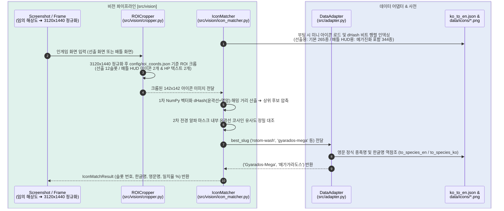

# 포챔스 배틀 어시스턴트 — Step 3: 화면 인식 및 비전 파이프라인 가이드 (Part 1~2: 선출 & 배틀 ROI·HUD 매칭)

포켓몬 챔피언스(포챔스) 배틀 어시스턴트의 **Step 3: 화면 정보 구조화 및 비전 인식 파이프라인** 중 현재까지 완료된 **Step 3-1(포챔스 에셋 구축 및 선출 화면 6마리 아이콘 매칭)** 및 **Step 3-2(배틀 화면 고정 ROI 확장 및 배틀 HUD 미니 아이콘 기반 일반/메가진화 포켓몬 식별)**의 구현 내용, 아키텍처 및 실행 가이드입니다.

---

## 1. 개요 (Overview)

인게임 선출 화면과 배틀 화면에서 텍스트 OCR 없이 순수 시각 특징(고정 미니 아이콘)만으로 선출 6마리 엔트리와 현재 필드에 나와 있는 아군/상대 포켓몬(메가진화 폼 포함)을 수 밀리초(2~5ms) 내에 100% 정확도로 식별하기 위한 기반 파이프라인을 구축했습니다.

* **영문 슬러그 파일명 기반 에셋 관리 (`data/icons/`, `data/sprites/`)**:
  * Windows 환경의 OpenCV 한글 경로 오류(`cv2.imread` 실패)와 Git 자모 분리 문제를 원천 차단하기 위해 모든 에셋은 ASCII 영문 소문자 슬러그(`salamence.png`, `gyarados-mega.png`, `rotom-wash.png` 등)로 저장합니다.
  * 별도의 ID 매핑 파일 없이 기존 `data/ko_to_en.json` 사전을 그대로 참조해 계산기용 정식 영문명과 콘솔 출력용 한글명을 양방향 변환(`to_species_en`, `to_species_ko`)합니다.
* **선출 화면 & 배틀 상태창(HUD) 단일 아이콘 매칭 아키텍처 (`src/vision/icon_matcher.py`)**:
  * 포챔스 인게임 분석 결과, 선출 화면의 6개 슬롯(`142x142`)뿐만 아니라 **배틀 화면 상단(상대 HUD)·하단(아군 HUD)에도 완전히 동일한 크기(`142x142`)의 공식 2D 미니 아이콘**이 고정 표시되며, 메가진화 시 즉시 메가진화 아이콘(`gyarados-mega.png` 등)으로 갱신됩니다.
  * 따라서 카메라 앵글이 계속 변하고 이펙트에 가려지는 필드 3D 모델을 비교할 필요 없이, **HUD 미니 아이콘 매칭 하나로 일반 폼과 메가진화 폼(X/Y/Z 포함)을 2~3ms 내에 확정**합니다. (`data/sprites/`의 3D 정면 렌더링 에셋은 향후 GUI 대시보드 일러스트 표시용으로 보존합니다.)
* **해상도 자동 정규화 및 고정 ROI 크롭 (`config/roi_coords.json`, `src/vision/cropper.py`)**:
  * 입력 프레임이 `2340x1080` 등 다른 20:9 비율 해상도이더라도 내부적으로 기준 해상도(`3120x1440`)로 자동 정규화(`normalize_frame`)한 뒤, 선출 슬롯·배틀 HUD·체력(HP) 텍스트·페이즈 지시자 영역을 오차 없이 크롭합니다.

---

## 2. 패키지 설치 및 에셋 준비 (Setup Guide)

### 2.1 비전 필수 패키지 설치
가상환경(`.venv`)에 비전 캡처, 이미지 해시, 초경량 OCR 패키지를 설치합니다:

```powershell
pip install -r requirements.txt
```

### 2.2 포챔스 전용 미니 아이콘 다운로드 (필수) 및 3D 스프라이트 다운로드 (선택)
PokeAPI의 포챔스(`versions/generation-ix/champions`) 전용 저장소에서 `ko_to_en.json`에 등록된 347종(고유 영문 슬러그 344종, 리전폼·메가진화 포함)의 **공식 미니 아이콘(`128x128`)**을 병렬 다운로드합니다:

```powershell
# [필수] 비전 매칭용 공식 2D 미니 아이콘 다운로드 (data/icons/*.png, 128x128 RGBA, 344개)
python scripts/download_icons.py

# [선택] 향후 GUI 대시보드 일러스트용 3D 정면 스프라이트 다운로드 (data/sprites/*.png, 512x512 RGBA, 344개)
python scripts/download_sprites.py
```

---

## 3. 시스템 아키텍처 (Architecture)



### 3.1 프로젝트 파일 구조 (Step 3-1 ~ 3-2 기준)
> `✨ NEW`: Step 3에서 신규 생성된 파일/디렉토리  
> `🔄 UPDATED`: Step 3에서 확장 및 개선된 파일

```text
pochamps-assistant/
├── config/
│   └── roi_coords.json           # [✨ NEW] 기준 해상도(3120x1440), 선출 12슬롯, 페이즈 지시자, 배틀 HUD/HP ROI 정의
├── data/
│   ├── icons/                    # [✨ NEW] 포챔스 공식 미니 아이콘 344종 (128x128, Git 제외)
│   ├── sprites/                  # [✨ NEW] 포챔스 인게임 3D 정면 스프라이트 344종 (512x512, GUI용, Git 제외)
│   └── ko_to_en.json             # [🔄 UPDATED] 25개 성격(natures) 한영 매핑 통합
├── docs/
│   ├── STEP1_GUIDE.md            # Step 1: 계산 엔진 통합 가이드
│   ├── STEP2_GUIDE.md            # Step 2: 한영 데이터 링크 및 샘플 계산 가이드
│   └── STEP3_GUIDE.md            # [✨ NEW] 본 문서 (Step 3 비전 가이드)
├── scripts/
│   ├── update_ko_to_en.py        # CSV 기반 한영 사전 동기화 스크립트
│   ├── download_icons.py         # [✨ NEW] PokeAPI Champions 공식 2D 미니 아이콘 다운로더 (필수)
│   └── download_sprites.py       # [✨ NEW] PokeAPI Champions 3D 정면 스프라이트 다운로더 (선택/GUI용)
├── src/
│   ├── vision/
│   │   ├── __init__.py           # [✨ NEW] 비전 패키지 선언
│   │   ├── cropper.py            # [✨ NEW] 선출/배틀 고정 ROI 분할 및 디버그 오버레이/조각 이미지 저장
│   │   └── icon_matcher.py       # [✨ NEW] ImageHash(dHash) + 윤곽선 상관계수 기반 아이콘 매칭기 (일반/메가진화 지원)
│   ├── adapter.py                # [🔄 UPDATED] 슬러그 ➔ 한글명 역참조(to_species_ko) 추가 및 natures 연동
│   ├── calc_bridge.py            # Python ↔ Node.js IPC 서브프로세스 브릿지
│   └── schemas.py                # 데이터 스키마
├── tests/
│   └── screenshots/              # [✨ NEW] 기준 스크린샷(team_preview*, battle_command, battle_mega) 및 debug_crops
├── .gitignore                    # [🔄 UPDATED] 에셋(icons, sprites, csv), 녹화 영상(*.mp4), debug_crops 제외 규칙 추가
├── requirements.txt              # [🔄 UPDATED] 비전 패키지(mss, pywin32, opencv, Pillow, ImageHash, rapidocr) 추가
├── test_step3_1_vision.py        # [✨ NEW] Step 3-1 선출 화면 ROI 크롭 및 6마리 아이콘 매칭 범용 테스트
└── test_step3_2_vision.py        # [✨ NEW] Step 3-2 배틀 화면 ROI 크롭 및 배틀 HUD 아이콘(메가진화 포함) 매칭 테스트
```

---

## 4. 상세 구현 내역

### 4.1 포챔스 공식 에셋 다운로더 분리 (`scripts/download_icons.py`, `scripts/download_sprites.py`)
* 일반 2D 도트가 아닌 `PokeAPI/sprites`의 **`versions/generation-ix/champions`** 전용 에셋을 사용하며, 비전 필수 에셋과 향후 GUI 선택 에셋을 별도 스크립트로 분리했습니다.
  * **미니 아이콘 다운로더 (`scripts/download_icons.py`, 필수)**: `.../versions/generation-ix/champions/icons/{id}.png` ➔ `128x128` PNG 저장 (`data/icons/`)
  * **정면 3D 스프라이트 다운로더 (`scripts/download_sprites.py`, 선택)**: `.../versions/generation-ix/champions/{id}.webp` ➔ `512x512` PNG 변환 저장 (`data/sprites/`, 향후 GUI 대시보드 확장용)
* `ThreadPoolExecutor(max_workers=16)` 병렬 다운로드 및 캐시 검사를 통해 344종 전체를 약 5~10초 내에 다운로드합니다.

### 4.2 선출 및 배틀 화면 고정 ROI 크롭퍼 (`config/roi_coords.json`, `src/vision/cropper.py`)
* 한글 경로가 포함된 Windows 디렉토리에서도 안전하게 동작하도록 `np.fromfile` + `cv2.imdecode` / `cv2.imencode` 기반의 `imread_safe`, `imwrite_safe` 함수를 구현했습니다.
* 입력 이미지가 `2340x1080` 등 어떤 해상도이든 `normalize_frame()`을 통해 기준 해상도(`3120x1440`)로 자동 변환한 뒤 아래 고정 좌표를 잘라냅니다:
  1. **선출 화면 슬롯 (`mode="preview"`)**:
     * `enemy_team_slots` (상대 6슬롯): `x = 2444`, `y = [211, 379, 547, 715, 883, 1051]`, `w = 142, h = 142`
     * `ally_team_slots` (아군 6슬롯): `x = 940`, `y = [211, 379, 547, 715, 883, 1051]`, `w = 142, h = 142`
  2. **배틀 화면 핵심 ROI (`battle_rois`, `mode="battle"`)**:
     * `enemy_hud_icon` (상대 상단 HUD 포켓몬 아이콘): `{"x": 2416, "y": 61, "w": 142, "h": 142}`
     * `enemy_hp_text` (상대 남은 체력 `%` 텍스트): `{"x": 2720, "y": 160, "w": 175, "h": 65}`
     * `ally_hud_icon` (아군 하단 HUD 포켓몬 아이콘): `{"x": 193, "y": 1285, "w": 142, "h": 142}`
     * `ally_hp_text` (아군 남은 체력 `현재/최대` 텍스트): `{"x": 460, "y": 1380, "w": 215, "h": 60}`
  3. **화면 페이즈 판별용 지시자 (`phase_indicators`)**:
     * `team_preview_banner`, `command_banner`, `move_button_1` ~ `move_button_4`

### 4.3 미니 아이콘 매칭기 (`src/vision/icon_matcher.py`)
* **모드별 인덱스 구성**:
  * **선출 화면 (`include_mega_in_preview=False`, 기본값)**: 선출 화면에서는 메가진화 전 기본/리전폼만 등장하므로 메가진화를 제외한 **265종**만 인덱싱하여 오탐 가능성을 원천 차단합니다.
  * **배틀 화면 HUD (`include_mega_in_preview=True`)**: 배틀 중 메가진화 시 상태창 HUD 아이콘이 메가진화 아이콘으로 즉시 변경되므로 메가진화 폼을 포함한 **344종 전체**를 인덱싱하여 일반 폼과 메가진화 폼을 모두 식별합니다.
* **2단계 하이브리드 매칭 알고리즘**:
  1. **1차 초고속 해시 압축**: 투명 배경 아이콘을 중립 회색 배경에 합성한 뒤 Sobel 윤곽선 `dHash`와 명암 `dHash` 비트 행렬을 구축하고, NumPy 벡터화 XOR 연산으로 전체 도감과의 해밍 거리를 1ms 내에 계산해 상위 후보(`top_k=8`)를 압축합니다.
  2. **2차 전경 윤곽선 상관계수 확정**: 인게임 슬롯/HUD의 반투명 배경 영향을 배제하기 위해 후보 아이콘의 알파 마스크 내부 영역에서만 윤곽선 코사인 유사도를 대조하여 최종 포켓몬과 **일치율(%)**을 산출합니다.

---

## 5. 테스트 및 검증 방법 (Testing)

두 테스트 스크립트 모두 특정 포켓몬 이름을 하드코딩하지 않고, **슬롯/영역 크롭 규격, 에셋 파일 존재 여부, 한글 역참조 유효성, 최소 일치율(`>= 50.0%`)**을 범용적으로 검증하므로 새로운 스크린샷을 인자로 넣어 언제든 테스트할 수 있습니다.

### 5.1 Step 3-1: 선출 화면 ROI 크롭 및 6마리 아이콘 매칭 테스트
```powershell
$env:PYTHONIOENCODING = "utf-8"
# 기본 선출 화면 스크린샷 테스트
python test_step3_1_vision.py

# 특정 선출 화면 이미지 지정 테스트
python test_step3_1_vision.py tests/screenshots/team_preview.png
```

#### 실행 결과 예시 ([`team_preview_v1.png`](../tests/screenshots/team_preview_v1.png))
```text
🔍 [상대 엔트리 6마리 매칭 결과] (소요 시간: 15.71 ms)
   - 슬롯 1: 번치코          ➔ Blaziken           (blaziken.png, 일치율=73.9%)
   - 슬롯 2: 갑주무사         ➔ Golisopod          (golisopod.png, 일치율=70.1%)
   - 슬롯 3: 한카리아스        ➔ Garchomp           (garchomp.png, 일치율=64.7%)
   - 슬롯 4: 킬가르도         ➔ Aegislash-Shield   (aegislash-shield.png, 일치율=66.0%)
   - 슬롯 5: 드래펄트         ➔ Dragapult          (dragapult.png, 일치율=63.8%)
   - 슬롯 6: 갸라도스         ➔ Gyarados           (gyarados.png, 일치율=66.7%)

🔍 [내 엔트리 6마리 매칭 결과] (소요 시간: 9.89 ms)
   - 슬롯 1: 아머까오         ➔ Corviknight        (corviknight.png, 일치율=69.7%)
   - 슬롯 2: 타부자고         ➔ Gholdengo          (gholdengo.png, 일치율=79.8%)
   - 슬롯 3: 마스카나         ➔ Meowscarada        (meowscarada.png, 일치율=77.0%)
   - 슬롯 4: 킬라플로르        ➔ Glimmora           (glimmora.png, 일치율=74.6%)
   - 슬롯 5: 한카리아스        ➔ Garchomp           (garchomp.png, 일치율=76.4%)
   - 슬롯 6: 팬텀           ➔ Gengar             (gengar.png, 일치율=76.1%)
```

### 5.2 Step 3-2: 배틀 화면 ROI 크롭 및 배틀 HUD 아이콘(일반/메가진화) 매칭 테스트
```powershell
$env:PYTHONIOENCODING = "utf-8"
# 기본 배틀 스크린샷 2종(battle_command.png, battle_mega.png) 전체 테스트
python test_step3_2_vision.py

# 특정 배틀 화면 이미지 지정 테스트
python test_step3_2_vision.py tests/screenshots/battle_mega.png
```

#### 실행 결과 예시 (`battle_command.png` & `battle_mega.png`)
```text
============================================================
 [검증 2] 배틀 HUD 미니 아이콘 매칭 검증 (battle_command.png)
============================================================

🔍 [배틀 필드 포켓몬 HUD 아이콘 매칭 결과] (소요 시간: 4.98 ms)
   - 상대 필드 포켓몬: 번치코          ➔ Blaziken           (blaziken.png, 일치율=80.9%)
   - 아군 필드 포켓몬: 한카리아스        ➔ Garchomp           (garchomp.png, 일치율=77.3%)

============================================================
 [검증 2] 배틀 HUD 미니 아이콘 매칭 검증 (battle_mega.png)
============================================================

🔍 [배틀 필드 포켓몬 HUD 아이콘 매칭 결과] (소요 시간: 5.43 ms)
   - 상대 필드 포켓몬: 메가갸라도스       ➔ Gyarados-Mega      (gyarados-mega.png, 일치율=79.1%)
   - 아군 필드 포켓몬: 아머까오         ➔ Corviknight        (corviknight.png, 일치율=84.6%)
```
